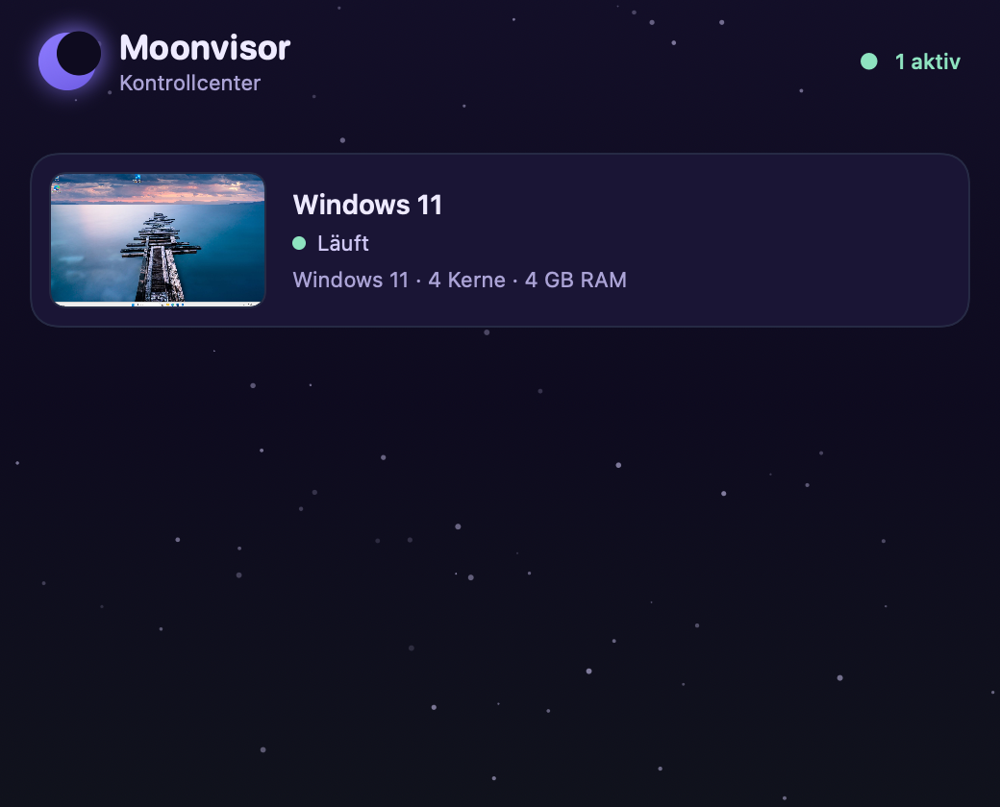
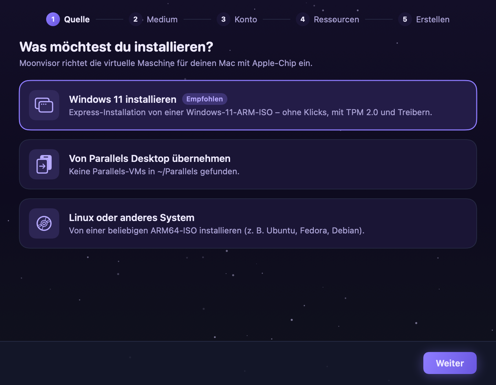
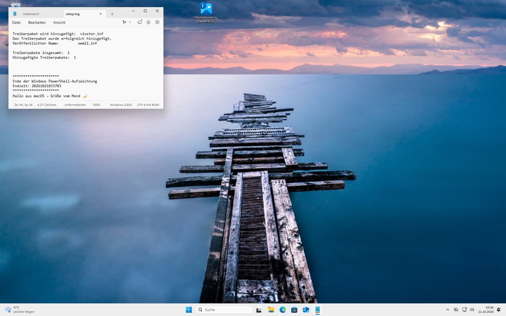

# 🌙 Moonvisor

**Windows 11 auf dem Mac mit Apple-Chip – Open Source, im Moon-Design.**

Moonvisor ist eine Virtualisierungs-App für macOS nach dem Vorbild von Parallels Desktop: Kontrollcenter, Installationsassistent mit Express-Installation, VM-Fenster mit eingebautem Bildschirm, Konfiguration, Schnappschüsse und eine Kommandozeile. Alles in Nachtblau und Lila.



| Installationsassistent | Windows 11 in Moonvisor – Text aus der Mac-Zwischenablage eingefügt |
| --- | --- |
|  |  |

## Was kann Moonvisor?

| | |
| --- | --- |
| **Windows 11 ARM** | Läuft nativ über Apple **Hypervisor.framework** (keine Emulation). UEFI-Firmware, **TPM 2.0**, NVMe-Festplatte. |
| **Express-Installation** | ISO auswählen, Benutzername eingeben, fertig. Partitionierung, Edition, lokales Konto, Datenschutzseiten und Treiber erledigt Moonvisor – ohne einen Klick im Windows-Setup. |
| **Automatische Treiber** | Lädt die virtio-Treiber (Netzwerk, Grafik, Speicher, Balloon …) und installiert die ARM64-Versionen beim ersten Login. |
| **Moonvisor Tools** | Kleiner Agent im Gast (wie die Parallels Tools): **gemeinsame Zwischenablage** für Text, Bilder und Dateien in beide Richtungen, **Dateien per Drag & Drop** in die VM und **Auflösung exakt passend zum Fenster**. Wird bei der Express-Installation automatisch eingerichtet, sonst per Doppelklick von der CD „MOONTOOLS“. |
| **Kontrollcenter** | Alle VMs mit Live-Vorschau, Status und Schnellstart. |
| **DirectX 11 (experimentell)** | Grafikmodus mit 3D-Beschleunigung über Triton, Neptune und DXMT auf Metal. Moonvisor lädt und richtet den Treiber selbst ein. |
| **VM-Fenster** | Bildschirm direkt im Fenster, Tastatur positionsgenau (deutsches Layout, AltGr, Funktionstasten), Maus ohne „Einfangen“, Anhalten, Herunterfahren, Neustart, Strg+Alt+Entf. |
| **Schnappschüsse** | Von laufenden VMs inklusive Arbeitsspeicher (dauert wenige Sekunden) oder von ausgeschalteten. Beim Wiederherstellen setzt Windows genau an der Stelle fort, auch wenn die Hardware inzwischen geändert wurde: Moonvisor stellt die Hardware des Schnappschusses mit wieder her. |
| **Konfiguration** | CPU, RAM, Festplatte vergrößern und bereinigen, CD/DVD, Ton, TPM, Grafikmodus, ⌘ als Strg. Netzwerk als NAT mit Portweiterleitung, mit **eigener IP-Adresse** (vom Mac direkt erreichbar) oder als **Bridge** ins lokale Netz. |
| **Parallels-Import** | Übernimmt VMs aus `~/Parallels` (Name, CPU, RAM, Festplatte). Das Original bleibt unangetastet. |
| **`moonctl`** | Alles auch im Terminal, ähnlich wie `prlctl`. |
| **Hintergrund-VMs** | VMs laufen weiter, wenn die App geschlossen wird. Beim nächsten Öffnen verbindet sich Moonvisor wieder. |

## Voraussetzungen

- Mac mit **Apple-Chip** (M1 bis M4 und neuer), macOS 14 Sonoma oder neuer
- Sonst nichts: Die Virtualisierungs-Engine (QEMU, TPM, UEFI-Firmware und die 3D-Bausteine) lädt Moonvisor beim ersten Start **selbst herunter**, mit Fortschrittsanzeige und Prüfsumme. Homebrew und das Terminal werden nicht gebraucht.
- Eine **Windows 11 ARM64-ISO** – kostenlos bei Microsoft:
  [microsoft.com/software-download/windows11arm64](https://www.microsoft.com/de-de/software-download/windows11arm64)
  (Moonvisor findet ISOs in *Downloads* und im Parallels-Download-Ordner automatisch.)
- Etwa 20 GB freier Speicher pro Windows-VM (die Festplatte wächst nur mit den belegten Daten)

## Installation

1. `Moonvisor-…-arm64.dmg` aus den [Releases](https://github.com/Luna-OS/moonvisor/releases) laden und Moonvisor in *Programme* ziehen.
2. Moonvisor ist (noch) nicht von Apple notarisiert. Beim ersten Start daher **Rechtsklick → Öffnen**, oder einmal im Terminal:
   ```bash
   xattr -dr com.apple.quarantine /Applications/Moonvisor.app
   ```
3. Moonvisor öffnen → **Neue VM erstellen** → *Windows 11 installieren*.

Ab 0.2.19 aktualisiert sich Moonvisor selbst: Es sucht beim Start und alle sechs Stunden auf GitHub nach einer neuen Version, lädt sie, prüft sie gegen `SHA256SUMS.txt` und installiert sie beim Beenden (oder sofort über „Jetzt neu starten“). Laufende VMs laufen dabei weiter. Abschalten lässt sich das in den Einstellungen.

Optional die Kommandozeile verfügbar machen:

```bash
sudo ln -sf /Applications/Moonvisor.app/Contents/Resources/bin/moonctl /usr/local/bin/moonctl
```

## Kommandozeile

```text
moonctl list                               Alle VMs mit Status
moonctl doctor                             Prüft QEMU, swtpm und Firmware
moonctl create-windows --iso <pfad> [--name N] [--user U] [--password P]
                       [--cpus 4] [--memory 4096] [--disk 64] [--edition pro|home] [--manual]
moonctl import-parallels <pfad.pvm>        Parallels-VM übernehmen
moonctl start <vm> [--wait]                Starten
moonctl stop <vm> [--force]                Herunterfahren (--force: sofort aus)
moonctl restart | pause | resume | ctrl-alt-del <vm>
moonctl screenshot <vm> <datei.png>
moonctl snapshot list|create|revert|delete <vm> [name]
moonctl delete <vm>                        In den Papierkorb legen
```

## Wie funktioniert das?

Vor dem Bau hat Moonvisor sich angesehen, **wie Parallels Desktop aufgebaut ist** – nur von außen: Bundle-Struktur, verlinkte System-Frameworks, Entitlements und das offene XML-Format der VM-Konfiguration. Es wurde kein Parallels-Code dekompiliert oder übernommen; Moonvisor ist komplett eigenständig geschrieben.

Die wichtigste Erkenntnis: Parallels startet Windows-VMs in einem eigenen Prozess auf Apples **Hypervisor.framework** mit eigener Geräteemulation (macOS-VMs dagegen über Virtualization.framework, das Windows nicht unterstützt). Moonvisor macht dasselbe mit offener Software:

```
┌─────────────────────────────── Moonvisor.app (SwiftUI) ───────────────────────────────┐
│  Kontrollcenter · Assistent · VM-Fenster · Konfiguration           moonctl (CLI)      │
│        │                         │ RFB/VNC über Unix-Socket            │              │
│        └──────────── MoonvisorCore ──────────┴──── QMP (JSON) ─────────┘              │
└────────────────────────────────────┬──────────────────────────────────────────────────┘
                                     │ startet
        ┌────────────────────────────┼─────────────────────────────┐
        ▼                            ▼                             ▼
  QEMU (virt, -accel hvf)       swtpm (TPM 2.0)            edk2 UEFI-Firmware
  Hypervisor.framework          pro VM eigener Zustand     + NVRAM pro VM
  NVMe · virtio-net · virtio-ramfb/virtio-gpu · xHCI-Tastatur/Tablet · HDA-Ton
```

- **Engine:** wird in CI aus den Quellen gebaut (`engine/`, Workflow `engine.yml`), mit der Build-Kette von [UTM](https://github.com/utmapp/UTM): QEMU mit Hypervisor.framework, swtpm, UEFI-Firmware, virglrenderer mit Neptune, ANGLE und DXMT, dazu `socket_vmnet` für das vmnet-Netzwerk. Das Paket liegt als Release `engine-<version>` bei; die App lädt es nach `~/Library/Application Support/Moonvisor/Engine`.

- **Eine VM ist ein Ordner** `~/Moonvisor/Name.moonvm` mit `config.json`, `disk.qcow2` (dünn belegt, interne Schnappschüsse), `efi-vars.fd`, `tpm/` und der Setup-CD.
- **Express-Installation:** Moonvisor erzeugt eine kleine CD `MOONSETUP` mit `autounattend.xml` (Partitionierung, Edition per generischem Microsoft-Installationsschlüssel ohne Aktivierung, lokales Konto, Überspringen der Hardware- und Online-Prüfungen) und einem Skript für den ersten Login, das die ARM64-virtio-Treiber per `pnputil` installiert.
- **Moonvisor Tools:** ein virtio-serial-Port `io.moonvisor.agent` verbindet die App mit einem PowerShell/C#-Agenten im Gast. Er trägt die Fenstergröße als eigene Auflösung im virtio-GPU-Treiber ein (`D3DKMTEscape`, wie das virtio-win-Hilfsprogramm), gleicht die Zwischenablage ab und überträgt Dateien. Neuere Versionen aktualisieren sich selbst.
- **Netzwerk mit eigener IP:** Apple gibt vmnet nur mit Administratorrechten frei. Moonvisor richtet dafür einmalig einen kleinen Systemdienst ein (`socket_vmnet` aus der Engine, gestartet von launchd); macOS fragt dabei nach dem Administrator-Passwort.
- **Bildschirm:** ein eigener RFB-Client mit QEMU-Scancode-Erweiterung, damit jede Mac-Taste positionsgenau ankommt. Im DirectX-Modus ein eigener, schlanker SPICE-Client: QEMU rendert über virglrenderer/Neptune und DXMT auf Metal in eine IOSurface, die das Fenster direkt anzeigt.
- **Steuerung:** QMP über einen Unix-Socket (Anhalten, Herunterfahren, Schnappschüsse, Bildschirmfotos).

## Grenzen (ehrlich)

Moonvisor ist jung. Was Parallels kann und Moonvisor (noch) nicht:

- **DirectX 11 ist experimentell.** Im Grafikmodus „DirectX 11“ lädt Moonvisor den Treiber [Triton](https://blog.getutm.app/2026/introducing-triton-directx-11-driver-for-qemu/) aus den UTM-Gasttools und richtet ihn über die Moonvisor Tools in Windows ein (Windows startet dafür zwei- bis dreimal neu). Das Bild kommt dann über SPICE als IOSurface in das VM-Fenster. Triton ist noch jung: nicht jedes Spiel läuft, DirectX 9 und 12 nicht.
- **Bildschirmauflösung:** Während des Setups 800×600, danach passt sie sich dem Fenster an. Windows erlaubt mindestens 1024×768; kleinere Fenster zeigen das Bild verkleinert.
- **Kein Coherence-Modus.** Drag & Drop geht vom Mac in die VM (Dateien landen auf dem Windows-Schreibtisch). Von Windows zum Mac geht es über die Zwischenablage: in Windows kopieren, im Finder einsetzen. Über die Zwischenablage gehen bis zu 256 MB auf einmal.
- **Ton nur als Ausgabe, kein Mikrofon.** Die CoreAudio-Anbindung von QEMU kann keine Aufnahme.
- **Moonvisor Tools ab Version 4** sind für Dateien, Bilder und die freie Auflösung nötig. Bestehende VMs brauchen dafür einmal „Moonvisor Tools installieren“ von der CD „MOONTOOLS“; danach aktualisieren sich die Tools selbst.
- **Schnappschüsse mit Arbeitsspeicher**, die vor dieser Version entstanden sind, kennen ihre Hardware noch nicht. Nach Änderungen an CPU, RAM, Grafik oder Ton startet die VM aus so einem Schnappschuss nicht.
- Windows-Aktivierung erfordert eine eigene Lizenz.

## Selbst bauen

```bash
git clone https://github.com/Luna-OS/moonvisor.git
cd moonvisor
swift test                       # Unit-Tests
scripts/build-app.sh 0.1.0       # baut dist/Moonvisor.app, ZIP und DMG
```

Benötigt Xcode 16 oder neuer (Swift 5.10+).

**Neue Version veröffentlichen:** Versionshinweise als `docs/releases/<version>.md` auf `main` bringen. Der Workflow `release.yml` baut daraus das Release `v<version>` (DMG, ZIP, Prüfsummen). Er wartet dabei auf das passende Engine-Release. Die Engine baut der Workflow `.github/workflows/engine.yml` (mehrere Stunden, das Ergebnis wird zwischengespeichert).

## Lizenz

Moonvisor steht unter der [MIT-Lizenz](LICENSE).

Die App selbst bündelt keine Fremdsoftware. Die separat heruntergeladene Engine enthält Komponenten unter deren eigenen Lizenzen, unter anderem [QEMU](https://www.qemu.org) (GPL-2.0), [swtpm](https://github.com/stefanberger/swtpm) (BSD-3-Clause), [edk2](https://github.com/tianocore/edk2) (BSD-2-Clause-Patent), [virglrenderer](https://gitlab.freedesktop.org/virgl/virglrenderer) (MIT), [ANGLE](https://chromium.googlesource.com/angle/angle) (BSD-3-Clause), [DXMT](https://github.com/3Shain/dxmt) (LGPL-2.1) und [socket_vmnet](https://github.com/lima-vm/socket_vmnet) (Apache-2.0). Sie wird mit der Build-Kette von [UTM](https://github.com/utmapp/UTM) (Apache-2.0) gebaut; Quellen und Patches stehen dort und in `engine/`. Die [virtio-win-Treiber](https://github.com/virtio-win/virtio-win-pkg-scripts) (BSD-3-Clause/GPL-2.0) und für DirectX die [UTM-Gasttools](https://github.com/utmapp/qemu/releases) mit dem Treiber Triton lädt Moonvisor bei Bedarf herunter.

Moonvisor ist ein unabhängiges Projekt und steht in keiner Verbindung zu Parallels International GmbH oder Microsoft. „Parallels“ und „Windows“ sind Marken ihrer jeweiligen Inhaber.
